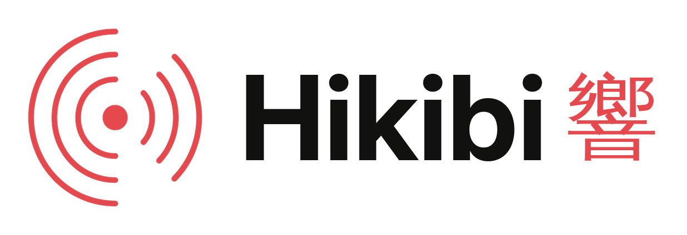

  <a href="https://hikibi.io">
    <picture>
      <source media="(prefers-color-scheme: dark)" srcset="assets/wordmark-dark.png">
      
    </picture>
  </a>

<b>Realtime messaging and push notifications for Asia-Pacific.</b>

  <a href="https://hikibi.io">Website</a> ·
  <a href="https://hikibi.io/guides">Guides</a> ·
  <a href="https://hikibi.io/migrate">Migrate</a> ·
  <a href="https://hikibi.io/pricing">Pricing</a> ·
  <a href="https://status.hikibi.io">Status</a>

---

**Hikibi 響** is a hosted realtime service run from Asia-Pacific. It gives
your apps two things:

- **Realtime WebSockets** — public, private, presence and encrypted channels
  over a Pusher-compatible protocol, so existing clients such as `pusher-js`
  and Laravel Broadcasting / Echo connect by changing the host and keys.
  Signed webhooks, usage analytics and a free plan are included.
- **Push notifications** — send to iOS, Android and browsers through a
  Beams-compatible API. Push is included in every plan at no extra cost.

## Open-source SDKs

The Hikibi service itself is closed source. The client SDKs in this
organization are open source:

| Repository | Platform | Install |
|---|---|---|
| [hikibi-push-android](https://github.com/hikibi-io/hikibi-push-android) | Android (Kotlin/Java), package `io.hikibi.push` | JitPack |
| [hikibi-push-ios](https://github.com/hikibi-io/hikibi-push-ios) | iOS (Swift), module `HikibiPush` | Swift Package Manager |
| `@hikibi/push-web` (coming soon) | Web push for browsers | npm |

The push SDKs are forks of the MIT-licensed Pusher Beams client SDKs and keep
their original license and copyright notices.

## Getting help

- Start with the [guides](https://hikibi.io/guides) and the
  [migration guide](https://hikibi.io/migrate).
- Found a bug in an SDK? Open an issue in that SDK's repository.
- Account, billing or service questions: **support@hikibi.io**
- Security issues: **security@hikibi.io** — please don't open a public issue.
  See our [security policy](https://github.com/hikibi-io/.github/blob/main/SECURITY.md).

---

Pusher, Pusher Channels and Pusher Beams are trademarks of their
respective owner. Hikibi is an independent service and is not affiliated
with, endorsed by or sponsored by Pusher or its owner. "Pusher-compatible" and
"Beams-compatible" describe protocol and API compatibility only.
